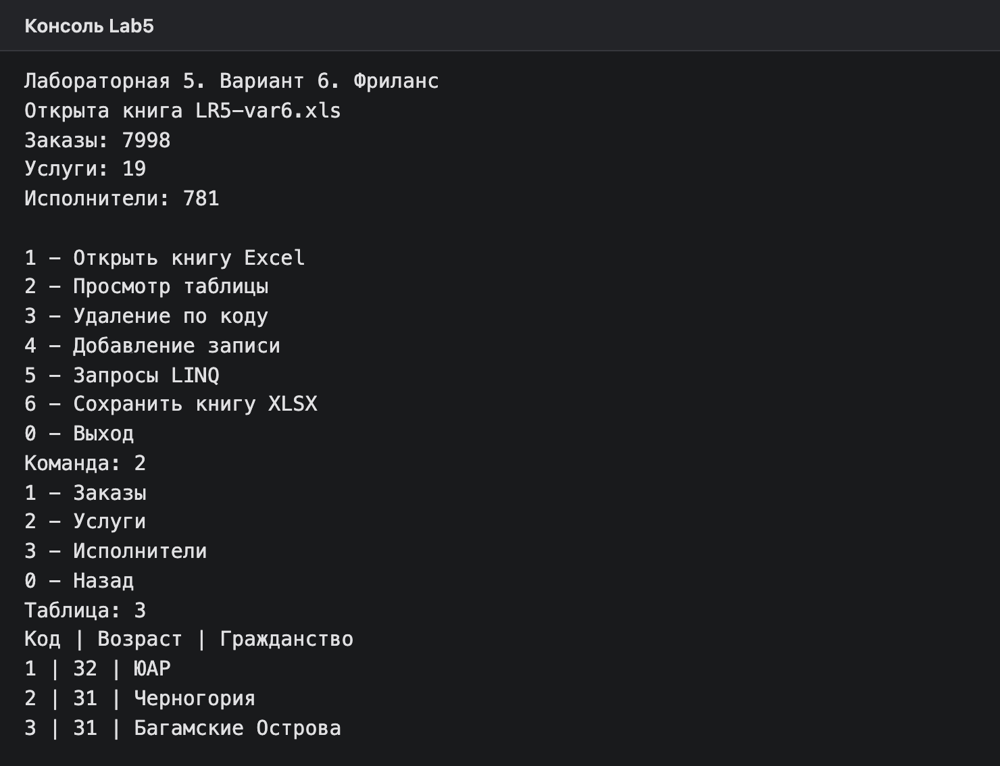
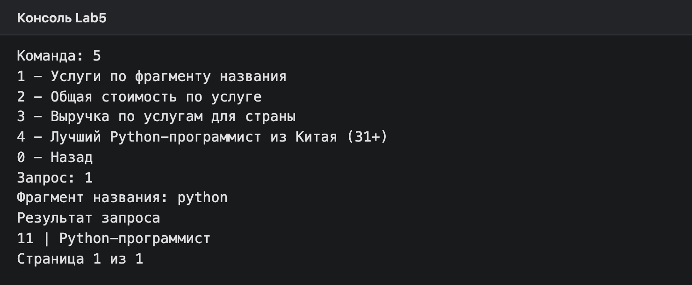
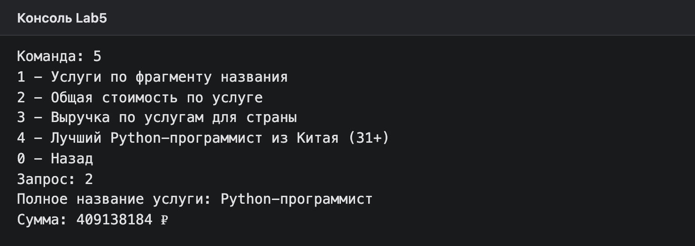
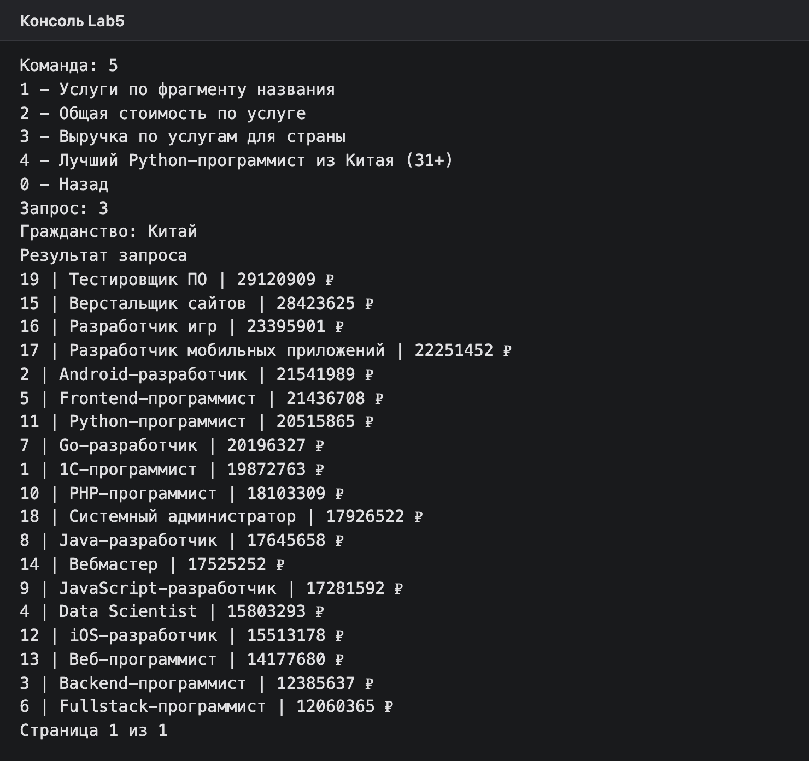
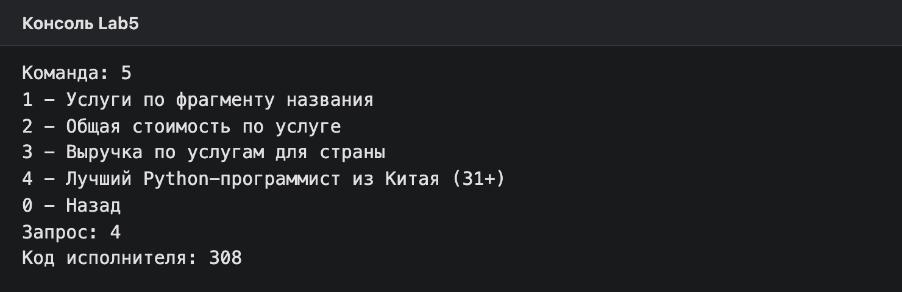
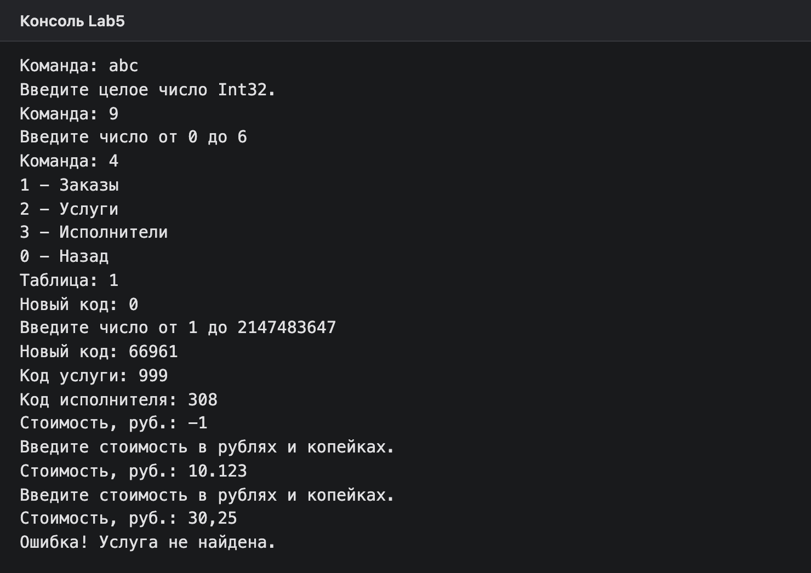
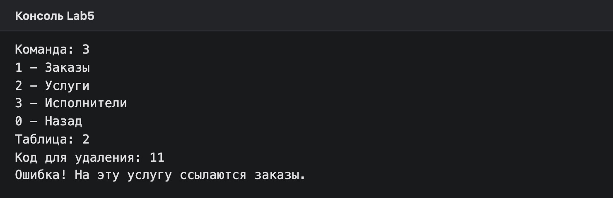
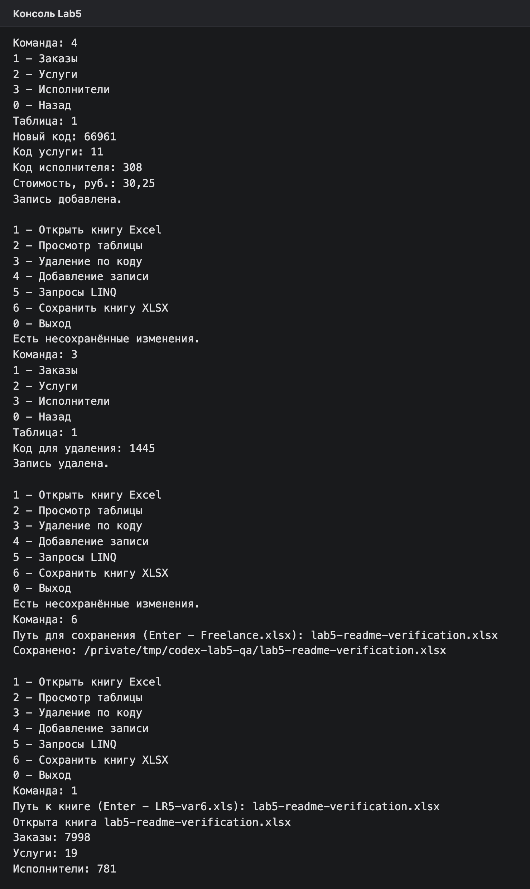
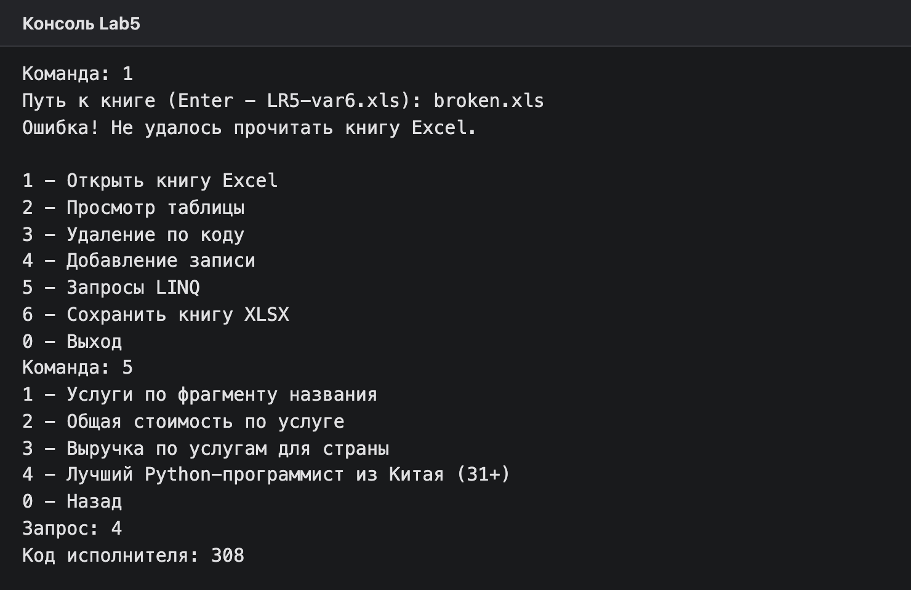

# Козарчук Никита ИТ-2 Лабораторная №5

Вариант 6. LINQ-запросы.

## Оглавление

- [Задача 6. База данных «Фриланс»](#задача-6)
- [Запуск](#запуск)

# Задание

## Задача 6

### Текст задачи

Разработать консольное приложение для работы с базой данных «Фриланс» из файла `LR5-var6.xls`. Программа должна читать и показывать таблицы, добавлять и удалять записи по ключу, выполнять четыре LINQ-запроса и сохранять изменения в книге Excel. При вводе с клавиатуры и загрузке книги требуется проверять данные.

В базе три таблицы: «Заказы» содержит код заказа, коды услуги и исполнителя и стоимость в рублях. «Услуги» содержит код и название, «Исполнители» — код, возраст и гражданство. Код услуги и код исполнителя в заказе ссылаются на соответствующие записи в справочниках.

| № | Формулировка запроса | Таблицы | Результат |
| --- | --- | --- | --- |
| 1 | Найти услуги, в названии которых есть заданный фрагмент. | Услуги | Список услуг |
| 2 | Подсчитать общую стоимость заказов по полному названию услуги. | Заказы, услуги | Сумма в рублях |
| 3 | Вывести услуги, оказанные исполнителями с заданным гражданством, и выручку по каждой услуге в порядке убывания. | Заказы, услуги, исполнители | Список услуг с суммами |
| 4 | Определить код исполнителя старше 30 лет с гражданством Китая, который больше всех заработал на услуге «Python-программист». | Заказы, услуги, исполнители | Код исполнителя |

### Алгоритм решения

1. При запуске открыть `LR5-var6.xls` через `ExcelDataReader` из библиотеки [Sylvan.Data.Excel](https://www.nuget.org/packages/Sylvan.Data.Excel/0.5.8). Один и тот же интерфейс читает листы и типизированные значения ячеек из XLS и XLSX.
2. Найти нужные листы и столбцы по заголовкам. Преобразовать строки в объекты `Order`, `Service` и `Contractor`. Проверить типы ячеек, уникальность ключей и наличие услуги и исполнителя для каждого заказа. При ошибке вывести сообщение и оставить открытой текущую базу. Для формул библиотека читает сохранённый в книге результат. Проверки применяются к этому значению.
3. Для просмотра выбрать таблицу. Методы `Skip()` и `Take()` выбирают до 20 записей на странице. При добавлении проверить код, значения полей и ссылки заказа. Для удаления найти запись по коду и проверить, ссылаются ли на неё заказы.
4. Выполнить выбранный запрос. В запросе 1 отобрать услуги через `where` и `Contains()`, затем отсортировать по коду. В запросе 2 соединить заказы с услугами по коду услуги и применить `Sum()`. Для запросов 3 и 4 метод `OrdersWithDetails()` соединяет все три таблицы через `join`. В запросе 3 отобрать исполнителей по гражданству, сгруппировать заказы по услугам и отсортировать суммы по убыванию. В запросе 4 применить фильтры по гражданству, возрасту и названию услуги. Сгруппировать строки по коду исполнителя и выбрать первый код в порядке убывания суммы. При равной выручке выбрать меньший код.
5. Сохранить три таблицы в книгу `.xlsx`. Для каждого листа `FreelanceFile` формирует `DataTable` с заголовками и типами столбцов и передаёт его в `ExcelDataWriter` из Sylvan.Data.Excel. После записи стандартные средства .NET добавляют тип заливки в пустой стиль, который создаёт Sylvan 0.5.8. Сохранённую книгу можно заново открыть через пункт 1.

При вводе кодов допускаются целые числа от 1 до `int.MaxValue`. Возраст указывается целым числом от 1 до 150. Стоимость должна быть неотрицательной, с точностью до копейки. Разделитель дробной части может быть запятой или точкой. Название и гражданство проверяются на пустые строки.

### Поля класса

- `FreelanceDatabase` хранит три закрытых списка: `_orders`, `_services` и `_contractors`.
- `Program` хранит открытую базу в поле `_database` и признак несохранённых изменений в поле `_changed`.
- `Order`, `Service` и `Contractor` хранят данные в свойствах только для чтения.

### Конструкторы, свойства и методы

- Первичный конструктор `Order(int id, int serviceId, int contractorId, decimal price)` заполняет свойства `Id`, `ServiceId`, `ContractorId` и `Price`.
- Первичный конструктор `Service(int id, string name)` заполняет свойства `Id` и `Name`.
- Первичный конструктор `Contractor(int id, int age, string citizenship)` заполняет свойства `Id`, `Age` и `Citizenship`. Все три класса переопределяют `ToString()` для вывода записи в консоль.
- Конструктор `FreelanceDatabase` принимает три списка, проверяет ключи и связи. Свойства `Orders`, `Services` и `Contractors` предоставляют списки для просмотра.
- Методы `AddOrder()`, `AddService()` и `AddContractor()` добавляют проверенную запись. `RemoveOrder()`, `RemoveService()` и `RemoveContractor()` удаляют запись по ключу и возвращают признак успеха. Услуга или исполнитель удаляются после удаления связанных заказов.
- `FindServices()`, `SumOrdersByService()`, `SumServicesByCitizenship()` и `FindTopContractor()` выполняют запросы 1–4. Текст сравнивается без учёта регистра.
- `Load()` и `Save()` передают ввод и вывод классу `FreelanceFile`. `ConsoleInput` обрабатывает ввод с клавиатуры, `Program` управляет меню.

### Тестирование

Проверка 1. Запустить программу и в меню выбрать 2, затем 3. Приложение открыло исходную книгу и прочитало 7 998 заказов, 19 услуг и 781 исполнителя. В таблице исполнителей показаны код, возраст и гражданство.



Проверка 2. Выбрать команду 5, запрос 1 и ввести `python`. Получен список из одной услуги «Python-программист» с кодом 11.



Проверка 3. Выбрать команду 5, запрос 2 и ввести «Python-программист». Получена общая стоимость заказов 409 138 184 ₽.



Проверка 4. Выбрать команду 5, запрос 3 и ввести «Китай». Получен список из 19 услуг по убыванию выручки. Первая строка — «Тестировщик ПО», 29 120 909 ₽.



Проверка 5. Выбрать команду 5 и запрос 4. Получен код исполнителя 308, который заработал 4 701 334 ₽ на заказах услуги «Python-программист». Код совпал с ответом из задания.



Проверка 6. Ввести `abc` и `9` вместо допустимой команды. При добавлении заказа ввести код `0`, затем цены `-1` и `10.123`. Программа запрашивает повторный ввод. Заказ с отсутствующим кодом услуги 999 отклонён.



Проверка 7. Выбрать команду 3, таблицу «Услуги» и код 11. Программа отклонила удаление, поскольку в заказах используется эта услуга.



Проверка 8. Добавить заказ 66961 на услугу 11 для исполнителя 308 стоимостью 30,25 ₽. Удалить заказ 1445, сохранить изменения через команду 6 и заново открыть полученную книгу через команду 1. В XLSX присутствует новый заказ, а удалённый отсутствует. Число заказов осталось равным 7 998.



Проверка 9. Попытаться открыть копию XLS с обрезанным содержимым. Программа сообщила об ошибке. Запрос 4 к ранее открытой базе снова вернул 308.



# Запуск

Требуется [.NET SDK 10](https://dotnet.microsoft.com/download/dotnet/10.0). Пакет Sylvan.Data.Excel восстанавливается из NuGet при сборке.

```bash
git clone https://github.com/Quiniful/lab5_csharp.git
cd lab5_csharp
dotnet run --project Lab5.csproj
```

Приложение автоматически открывает приложенный `LR5-var6.xls`. Команда 1 открывает книгу `.xls` или `.xlsx`, команда 6 сохраняет изменения в `Freelance.xlsx` или в файл с указанным именем. Команда 0 завершает работу.
